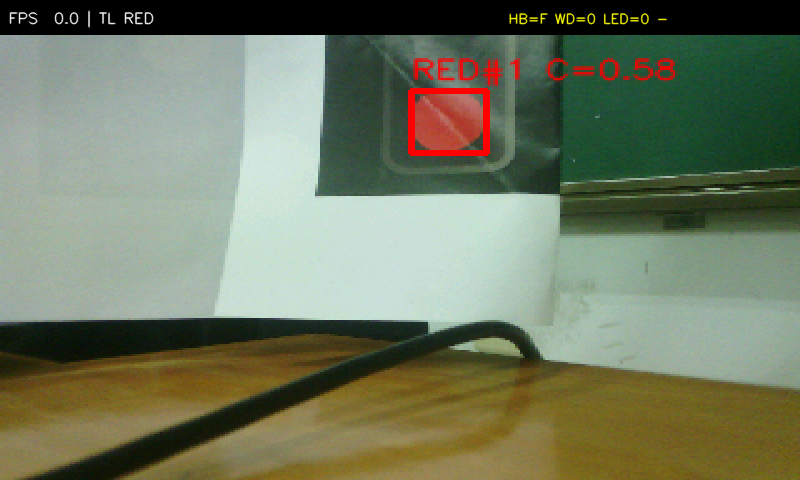
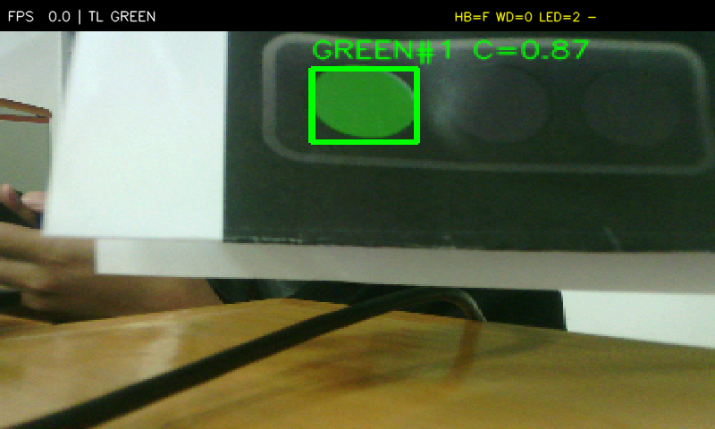
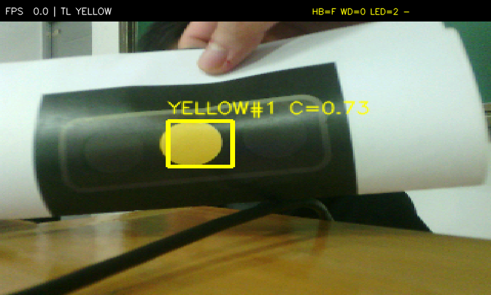
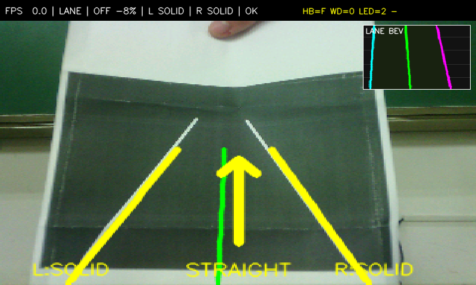
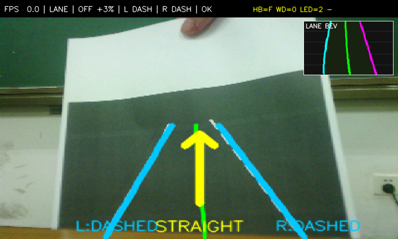
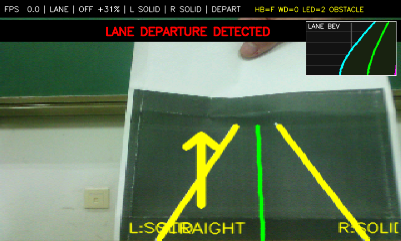
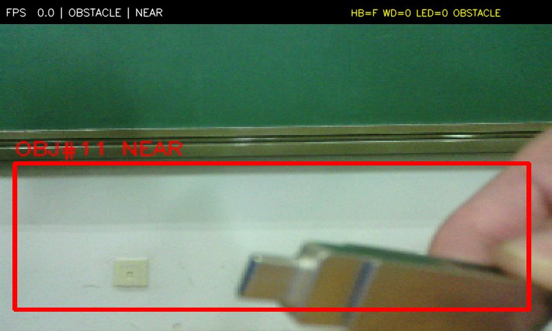

# 面向 ADAS 算法验证的 Zynq 软硬协同实时视觉平台

## 摘要

ADAS 视觉算法通常同时受到实时性、可复现性和失效安全性约束。真实道路测试成本高、场景不可重复；纯 PC 仿真又无法覆盖摄像头采集、FPGA 视频通路、板级时延以及 Linux 或 PS 卡死后的硬件行为。本作品基于 AMD ZYNQ-7010、OV5640 和 800×480 LCD，构建“摄像头 → PL → VDMA → PS 感知/OSD → LCD”的完整实时视觉平台，并以照片硬件在环（HIL）方式验证红绿灯、车道线和障碍物算法。

系统采用 PS+PL 异构架构。PL 完成视频采集、彩色/灰度预处理、VDMA 通路、决策 FSM、500 ms 看门狗、LED 与蜂鸣器控制；PS 使用 PYNQ、OpenCV 和 Python 完成感知与 OSD。PS 每成功处理并显示一帧才翻转心跳，因此相机 DMA 或上层处理卡死时，PL 可以不依赖 Linux 独立进入安全报警状态。车道模式进一步使用 PL RGB→灰度预处理，实测同场景吞吐由 19.54 FPS 提升至 20.52 FPS，提升约 5.02%。

项目通过 45 项自动测试。BSTLD 圆形红绿灯留出集准确率为 77.5%，无灯负样本为 10/10；TuSimple 虚实线侧标签留出集准确率为 80%；实线和虚线控制卡均达到 12/12。系统完成红绿灯、车道线、障碍物三种严格互斥模式，覆盖检测、BEV/偏航判断、声光执行、硬件看门狗和图片注入兜底，形成可演示、可测量和可复现的工程闭环。

关键词：照片 HIL；软硬协同；硬件安全岛；车道虚实线；Zynq

## 1. 项目目标与需求

### 1.1 应用背景

ADAS 原型开发不仅需要识别目标，还需要回答以下工程问题：

- 同一样本能否同时用于离线准确率验证和现场实时演示；
- 端到端视频通路是否稳定，是否明确处理分辨率、输出分辨率和帧率；
- 算法阈值和时序是否可重复验证；
- Linux、Jupyter 或 Python 线程停止后，底层执行是否仍然安全；
- PS 与 PL 之间的寄存器契约、模式隔离和恢复机制是否清楚。

因此，本作品不以“完整自动驾驶”为目标，而是构建面向算法验证的轻量级 HIL 平台。打印数据集照片作为可控输入，摄像头仍通过完整实时链路送入 FPGA 和 PS，而不是绕过硬件直接播放图片。

### 1.2 设计目标

| 目标 | 验收方式 |
|---|---|
| 完整实时链路 | OV5640、PL、VDMA、PS OpenCV、OSD 和 LCD 连续运行 |
| 多场景验证 | 红绿灯、车道线、障碍物三种互斥模式 |
| 可控场景复现 | A4 哑光打印图、固定相机、稳定的采集条件 |
| 硬件失效安全 | PS 停止心跳后 PL 在 500 ms 内进入报警态 |
| 可测量 | FPS、端到端处理延迟、准确率、资源和时序数据 |
| 可复现 | 独立 notebook、测试套件、构建脚本和证据目录 |
| 工程边界明确 | 主动说明圆形灯、固定场景和感知精度限制 |

### 1.3 项目边界

本平台用于教学、算法验证和原型演示，不是车规产品。当前版本不输出真实车辆控制量，不进行米制相机标定，也不具备完整道路泛化能力。KEY0 和 KEY1 是转向意图与强制指令的演示输入，LED 和蜂鸣器是执行状态代理，不代表真实车辆转向执行器。

## 2. 系统总体设计

### 2.1 硬件平台

| 组件 | 型号或规格 |
|---|---|
| FPGA/SoC | AMD ZYNQ-7010，`7z010clg400-1` |
| 开发板 | ALIENTEK 领航者 ZYNQ |
| 摄像头 | OV5640，DVP 接口 |
| 显示 | 800×480 LCD |
| 输入照片 | A4 哑光打印卡，必要时 A3 |
| 开发环境 | Vivado 2020.2、PYNQ 2.7 |

### 2.2 数据通路

```text
OV5640
  ↓ DVP
PL camera_in: colour bypass / hardware RGB→gray / AXI-Stream mux
  ↓
AXI VDMA S2MM → DDR frame buffer
  ↓
PS: OpenCV perception → decision fields → OSD composition
  ↓
AXI VDMA MM2S → LCD frontend

PS → AXI-Lite GPIO: 16-bit decision word
PL adas_decision → AXI-Lite GPIO: 7-bit status word
```

PL 与 PS 的逐帧交互只有一次控制字写入和一次状态字读取，不需要逐像素跨处理器通信。感知结果、模式状态和 OSD 均由 PS 组织，确定性视频搬运、决策执行和失效保护由 PL 承担。

### 2.3 三种工作模式

| 模式 | 有效检测器 | 其他检测器 | 主要输出 |
|---|---|---|---|
| `traffic_light` | 圆形红绿灯 | 关闭 | 灯色、停车/通行、声光提示 |
| `lane` | 左右车道与偏航 | 关闭 | 虚实线、BEV、偏移、报警 |
| `obstacle` | 小环境静态障碍物 | 关闭 | 目标框、近区报警、跟踪 ID |

切换模式时清空历史投票、跟踪框和偏航迟滞状态，避免上一模式的结果进入当前模式。

## 3. PL 硬件设计

### 3.1 视频预处理与 VDMA

PL 接收 OV5640 视频流，并通过可旁路流水线支持彩色和灰度输出。车道模式使用 PL 产生的灰度帧，PS 直接从通道数据构造灰度 ROI，不再执行 `cv2.cvtColor`；灰度路径同时跳过颜色伪图 HSV 转换。

相同实线卡、相同处理分辨率下的 A/B 结果为：

| 输入路径 | 平均 FPS | 识别结果 |
|---|---:|---|
| 彩色输入，PS 转灰度 | 19.54 | SOLID/SOLID |
| PL 灰度输入 | 20.52 | SOLID/SOLID |

该结果证明 PL 预处理对当前车道模式有真实吞吐收益。它是视频预处理级加速，不等同于将 Hough、拟合或分类算法全部硬件化。

### 3.2 决策 FSM

PS 写入的 16 位控制字定义如下：

```text
[1:0]  tl         0 无 / 1 红 / 2 绿 / 3 黄
[3:2]  ll         0 无 / 1 实线 / 2 虚线
[5:4]  lr
[6]    obstacle
[7]    force_ps
[9:8]  turn_ps
[10]   heartbeat
[15:11] reserved
```

PL 回读的 7 位状态为：

```text
[2:0] led
[3]   beep
[4]   wd_timeout
[6:5] alarm_reason
```

PYNQ 2.7 的 `channel1.write(value, mask)` 必须使用 `mask=0xFFFF`。若缺少写掩码，软件调用可能表面成功但实际没有更新任何控制位。

### 3.3 按键与执行逻辑

KEY0 循环切换直行、右转和左转意图；KEY1 用于红灯强制通行演示。硬件先进行 20 ms 去抖，再按控制字执行：

- 红灯且未强制：LED 全灭，短鸣；
- 红灯且 KEY1：三灯闪烁，持续报警；
- 实线且转向意图非直行：三灯闪烁，持续报警；
- 虚线且转向意图非直行：对应转向灯正常点亮；
- 障碍物进入近区：`obstacle=1` 并短鸣；
- 看门狗超时：优先级最高，LED 交替闪、蜂鸣器约 1 Hz。

### 3.4 硬件安全岛

心跳只在“读帧、感知、决策、OSD、显示写回”全部完成后翻转。若 PS 线程卡死超过 500 ms，看门狗进入安全态并置 `wd_timeout=1`；PS 恢复后，下一帧有效心跳自动清除超时。测试中注入 1.5 s 卡死，观测到 `wd=0→1→0`。

### 3.5 资源与时序

| 资源 | 使用量 | 总量 | 占用率 |
|---|---:|---:|---:|
| Slice LUT | 9739 | 17600 | 55.34% |
| Slice Register | 16564 | 35200 | 47.06% |
| Block RAM Tile | 10 | 60 | 16.67% |
| DSP | 3 | 80 | 3.75% |

Vivado 实现后 WNS 为 `+0.757 ns`，TNS 为 `0`，全部用户时序约束满足。

## 4. PS 感知设计

### 4.1 红绿灯检测

红绿灯检测先进行 HSV 颜色候选，再加入形状约束：圆度、凸度和拟合椭圆惯性比。这样可减少彩色矩形路牌、灯带和反光区域的误报。多帧状态机控制进入、换色和清除，避免单帧闪烁。

红色和绿色使用不同真实源图构建样本；黄色真实源框不足，因此黄色结果只作为控制卡验证和受限条件下的补充指标，不将其视为完整真实数据集准确率。







### 4.2 车道线检测

车道处理位于画面下方 ROI。在线 320×240 输入使用 PL 灰度结果，并在模块内部缩放到 208 宽。主要步骤为：

1. 生成白/黄涂料掩膜，白色候选要求足够的局部亮度提升，黄色候选同时检查色相和饱和度；
2. 使用涂料掩膜约束 Canny 边缘，抑制门框、柜边和纸张边界；
3. HoughLinesP 获得线段，按底端横坐标分左右并聚类；
4. 有历史轨迹时优先位置连续、斜率接近的候选；
5. 对候选点拟合直线，仅在二次拟合明显降低 RMSE 时使用二次曲线；
6. 沿曲线扫描涂料掩膜，利用覆盖率、最大暗间隙和暗间隙段数分类 SOLID/DASHED/NONE；
7. 要求左右车道同时存在、宽度合理，避免将单条背景边缘当成完整车道；
8. 最近 3 次曲线取中值，并采用 5 帧状态投票。

### 4.3 BEV 与偏航判断

BEV 使用固定单应矩阵，将下方梯形 ROI 映射为俯视矩形。小窗显示左边界、右边界和道路中心线，用于解释车道几何，不作为米制测量结果。

在画面底部计算左右边界：

```text
lane_width = right_x - left_x
center_x = (left_x + right_x) / 2
offset = (center_x - image_center) / image_half_width
```

有效车道宽度必须在画面宽度的 15%–110% 之间。绝对偏移超过 20% 并连续确认 3 次后进入 `DEPART`；回到阈值内并连续确认 2 次后清除。曲率显示为归一化二次项系数，不是物理 `1/m`。







### 4.4 障碍物检测

障碍物模式面向固定相机的小环境，而不是车辆等比例测距。系统先学习空场景背景，使用相位相关补偿轻微抖动，再通过背景差分、形态学、面积和宽高比筛选候选。目标经过多帧确认后输出框，并根据中心距离分配短时跟踪 ID。

只有目标中心进入画面下方中央近区时，才置 `obstacle=1` 并短鸣。墙体、桌面和大面积背景不作为障碍物输出。相机大幅平移或初始场景不空时，需要清空场景并调用 `relearn_background()`。



### 4.5 OSD 与图片注入

OSD 显示检测框、车道曲线、BEV、偏移、虚实线、FPS、心跳来源、LED、蜂鸣器和看门狗状态。LCD framebuffer 需要与 OpenCV BGR 顺序匹配，颜色问题必须使用色条和通道均值定位，不能通过修改感知阈值掩盖显示错误。

如果现场摄像头或照片不可用，图片注入可把预置 PPM 直接写入 LCD，保证演示流程有兜底路径。

## 5. 验证方案与结果

### 5.1 测试环境

| 项目 | 配置 |
|---|---|
| 内核 | PynqLinux 5.4.0-xilinx-v2020.2 |
| Python | 3.8.2 |
| NumPy | 1.20.3 |
| OpenCV | Ubuntu OpenCV 4.2.0 |
| pytest | 4.6.9 |
| 应用比特流 MD5 | `1f18cca001db496408ec85ec9cb301ea` |

### 5.2 自动测试

正式测试命令：

```bash
cd /home/xilinx/jupyter_notebooks/stage4
PYTHONPATH=. /usr/local/share/pynq-venv/bin/python3 -m pytest -q \
  tests/test_cards.py tests/test_overlay.py \
  tests/test_decision.py tests/test_perception.py
```

结果：45/45 通过。覆盖寄存器契约、红绿灯圆形门控、车道颜色掩膜、直线/曲线选择、虚实线间隙分类、偏航迟滞、目标 ID、模式隔离、OSD 和看门狗。

### 5.3 红绿灯数据

| 指标 | 结果 |
|---|---:|
| BSTLD 调参集 | 46/60，76.7% |
| BSTLD 留出集 | 31/40，77.5% |
| 留出集无灯负样本 | 10/10 |
| 真实圆灯卡红/绿/黄 | 各 20/20 |

### 5.4 车道数据

| 测试 | 结果 |
|---|---:|
| TuSimple 调参侧标签 | 15/20，75.0% |
| TuSimple 留出侧标签 | 16/20，80.0% |
| 打印实线卡 | 12/12 SOLID/SOLID |
| 打印虚线卡 | 12/12 DASHED/DASHED |
| 偏航报警 | OFF +38%，DEPART，obstacle=1 |
| 回正清除 | OFF +10%，OK，obstacle=0 |

### 5.5 性能

| 项目 | 结果 |
|---|---:|
| PL 直通 | 约 37.8 FPS |
| 红绿灯模式 | 23.0 FPS |
| 车道模式（PL 灰度） | 20.5 FPS |
| 障碍物模式 | 26.8 FPS |
| PL 灰度加速 | +5.02% |
| 看门狗 | 1.5 s 卡死后 `wd=0→1→0` |

分模式原始延迟数据保存在 `docs/evidence/latency_*.csv`。延迟计量覆盖 PS 读帧、感知、OSD 和显示提交，不是光电传感器测得的玻璃到玻璃延迟。

## 6. 实拍与提交照片

以下位置用于提交报名页面要求的高清实拍图。当前未用 LCD 截图冒充实拍；拍摄后按同名替换并重新生成 PDF。


实拍要求：

- 作品全貌图最多上传 1 张；
- 开发板重要角度图最多上传 4 张；
- JPG/PNG，每张不超过 10 MB；
- LCD 应显示正常 OSD；
- 避免反光、模糊、杂乱背景和与作品无关的个人信息；
- 不用桌面截图替代硬件照片。

## 7. 可复现性

四个独立 notebook 位于 `stage4/notebooks/`：

- `traffic_light.ipynb`；
- `lane.ipynb`；
- `obstacle.ipynb`；
- `full_demo.ipynb`。

每个 notebook 会自动把父目录加入 `sys.path`，无需手工修改 Python 路径。完整环境、板端部署、测试、交互式验证和 Stage 2 恢复步骤见 `docs/reproducibility.md`。

更换实拍照片后可运行：

```bash
py -3 stage4/tools/render_report_pdf.py \
  --output docs/report/adas_report_final.pdf
```

## 8. 已知局限与风险

- BSTLD 为本地部分镜像，黄色真实源框数量有限；
- TuSimple 不提供 SOLID/DASHED 标签，虚实线结果来自人工侧标签；
- 红绿灯算法只接受圆形灯，箭头灯主动拒绝；
- 车道虚实线分类依赖打印材质、光照和相机角度；
- BEV 与曲率未做物理相机标定，不能输出米制距离；
- 障碍物模式要求固定相机和空场景背景，不能做车辆尺度或真实距离估计；
- 系统不是车规安全产品，硬件看门狗只验证原型级失效保护；
- 当前 PL 加速范围为视频灰度预处理，不是完整感知加速器。

## 9. 结论

本项目完成了从摄像头输入、FPGA 视频通路、PS 视觉感知、OSD 显示到 PL 决策执行的完整闭环，并通过照片 HIL 将离线样本、现场输入和工程证据关联起来。系统在保持清晰模式边界和可复现测试的前提下，实现了车道几何、虚实线分类、偏航报警、障碍物跟踪和硬件失效安全。

作品的主要价值是软硬协同验证方法、确定性实时视频通路和硬件安全岛，而不是宣称已经达到量产 ADAS 能力。后续可在保持现有接口的前提下增加 PL 车道涂料掩膜或 ROI 下采样，以进一步提高软硬件协同收益。
